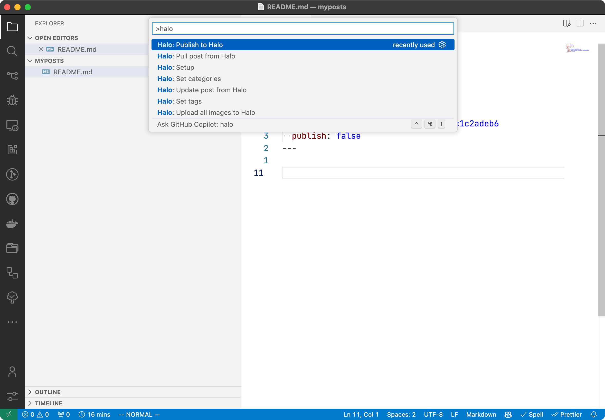
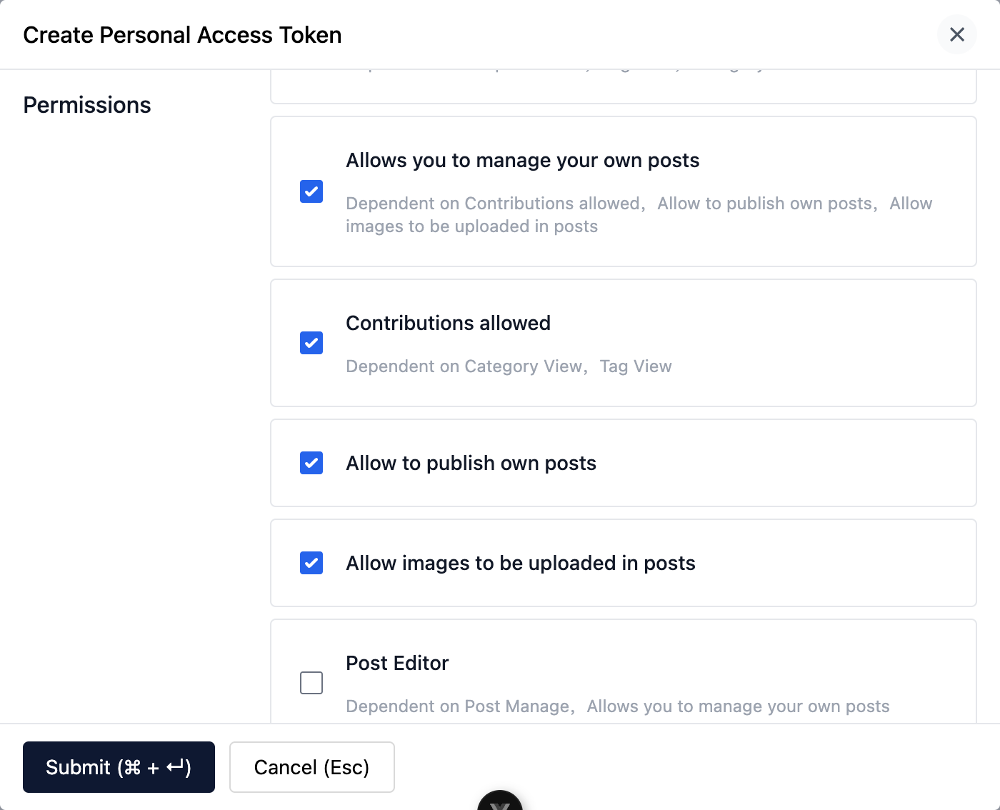

# Halo integration for Visual Studio Code

Visual Studio Code extension for publishing Markdown files to [Halo](https://github.com/halo-dev/halo)

[中文文档](./README.zh-CN.md)

## Preview



## Features

- Publish the current Markdown file to Halo (images included).
- Batch publish: select multiple files (or right-click a folder in the Explorer) and publish them all at once. Unchanged posts are skipped automatically, so re-publishing a whole folder costs almost no server requests.
- External image transfer: move images hosted elsewhere (e.g. image hosts that may go away) into the Halo attachment library while publishing.
- Pull posts from Halo into the local workspace, and overwrite the local document with the server version.
- Set categories and tags for the current post from the server's list.
- Explorer context menu with concise entries, per-file progress, and a dedicated output channel that logs the full process.

## Prerequisites

Before using this extension, make sure you have the following prerequisites:

- An available [Halo](https://github.com/halo-dev/halo) site
- Visual Studio Code: [Download here](https://code.visualstudio.com/download)

## Installation

1. Open Visual Studio Code
2. Go to Extensions
3. Search for **Halo**
4. Click the Install button
5. Reload Visual Studio Code to activate the extension

## Usage

1. Open the Command Palette and search for **Halo Setup**.
2. Fill in the relevant information for your Halo site according to the prompts.
   1. Site url: The URL of your Halo site, e.g. `https://example.com`
   2. Personal access token:

       The personal access token of your Halo site. Grant it the following permissions according to the features you use:

       | Feature | Permission (role template) |
       |---|---|
       | Publish / pull / update posts | `role-template-post-contributor` (Post Contributor) |
       | Publish posts by default / set `publish: true` | `role-template-post-publisher` (Post Publisher) |
       | Upload and transfer images | `role-template-uc-attachment-manager` (manage own attachments) |
       | Configure a custom storage policy or group | `role-template-manage-attachments` (manage attachments) |

       

       More information about personal access token: [Personal Access Token](https://docs.halo.run/user-guide/user-center#%E4%B8%AA%E4%BA%BA%E4%BB%A4%E7%89%8C)

3. Open a Markdown file, then open the command palette and search for **Halo Publish**. Once selected, this document will be published to the Halo site. You can also right-click files or folders in the Explorer for the same actions.
4. All available commands:
    - **vscode-extension-halo.setup**: Setup Halo site information.
    - **vscode-extension-halo.publish**: Publish the Markdown file to Halo.
    - **vscode-extension-halo.publish-batch**: Batch publish to Halo (unchanged posts are skipped automatically).
    - **vscode-extension-halo.pull**: Pull posts to local Markdown files (right-click a folder to pull into it).
    - **vscode-extension-halo.update**: Overwrite the local Markdown file with the server version.
    - **vscode-extension-halo.upload-images**: Upload images referenced in the Markdown file to Halo.
    - **vscode-extension-halo.config-image-upload**: Configure the storage policy / group for image upload and transfer.
    - **vscode-extension-halo.set-categories**: Set categories for current post.
    - **vscode-extension-halo.set-tags**: Set tags for current post.

    Common actions are also available from the Explorer context menu: batch publish / publish / update / upload images (on selected files or folders), and pull posts (on a selected folder, pulling into it).

## Settings

| Setting | Description |
|---|---|
| `halo.post.publishByDefault` | Publish the post by default when the frontmatter does not specify it (requires permission: publish own posts). |
| `halo.network.requestTimeout` | Timeout in seconds for regular requests (post create/update/publish etc.). Default 60. |
| `halo.network.uploadTimeout` | Timeout in seconds for image upload and download. Default 120. |
| `halo.post.slugStrategy` | Slug generation strategy for new posts: `timestamp` (default) or `pinyin` of the file name. A `slug` in the frontmatter always takes precedence. |
| `halo.image.transfer.enabled` | Transfer external images in the post to the Halo attachment library when publishing, in case the image hosts go away. |

The storage policy / group for image upload and transfer are not settings — run the **Halo: Configure image storage policy** command to configure them.

## Frontmatter

The extension keeps post metadata in the Markdown frontmatter. Supported fields:

```yaml
---
title: My post           # post title (defaults to the file name)
slug: my-post            # post slug (defaults to the configured slug strategy)
excerpt: ...             # manual excerpt (auto-generated when omitted)
cover: https://...       # cover image
date: 2024-01-01 08:00:00 # publish time pushed to the server on publish
categories: [Cat1, Cat2] # created on the server when missing
tags: [tag1, tag2]
halo:                    # managed by the extension — links the document to the post
  site: https://example.com
  name: <post name on the server>
  publish: true          # publish state; omit to use publishByDefault
  content-hash: ...      # local change detection, unchanged posts are skipped
---
```

## Contributing

Contributions, issues, and feature requests are welcome! Feel free to check the issues page.
