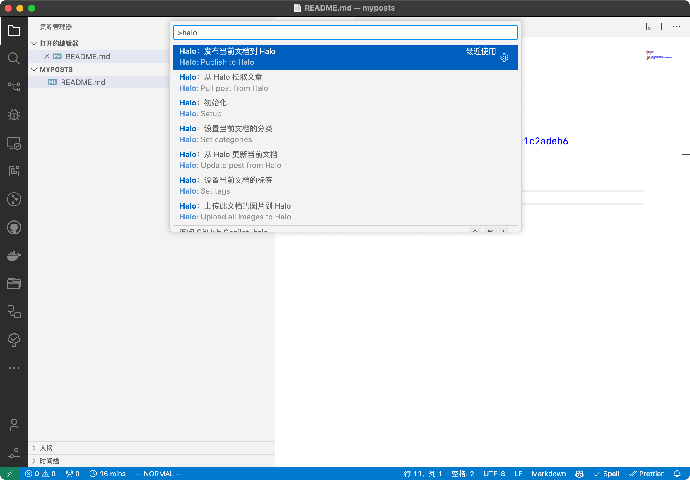
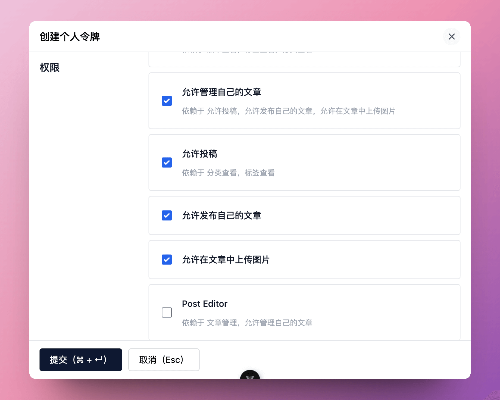

# VSCode 发布插件

用于将 Markdown 文件发布到 [Halo](https://github.com/halo-dev/halo) 的 Visual Studio Code 插件

[English](./README.md)

## 预览



## 功能

- 将当前 Markdown 文件发布到 Halo（图片一并处理）
- 批量发布：多选文件（或在资源管理器中右键目录）一键全部发布；内容未变更的文章自动跳过，重发整个目录几乎不产生服务器请求
- 外链图片转存：发布时将外部图床的图片转存到 Halo 附件库，防止图床失效
- 从 Halo 拉取文章到本地工作区，以及用服务器版本覆盖本地文档
- 从服务器分类/标签列表中为当前文章设置分类和标签
- 资源管理器右键菜单（精简文案）、逐文件进度提示、独立的输出通道记录完整过程

## 先决条件

在使用此插件之前，请确保满足以下先决条件：

- 一个可用的 [Halo](https://github.com/halo-dev/halo) 网站
- 安装 Visual Studio Code：[在此处下载](https://code.visualstudio.com/download)

## 安装

1. 打开 Visual Studio Code
2. 进入扩展页面
3. 搜索 Halo
4. 点击安装按钮
5. 重新加载 Visual Studio Code 以激活插件

## 使用方法

1. 打开命令面板，搜索 Halo 初始化
2. 根据提示填写 Halo 网站的相关信息
   1. 站点地址: Halo 网站的访问地址，示例：`https://example.com`
   2. 个人令牌:

       Halo 网站的个人令牌。按使用的功能授予以下权限：

       | 功能 | 所需权限（角色模板） |
       |---|---|
       | 发布 / 拉取 / 更新文章 | `role-template-post-contributor`（投稿者） |
       | 默认发布文章 / frontmatter 设置 `publish: true` | `role-template-post-publisher`（文章发布） |
       | 上传与转存图片 | `role-template-uc-attachment-manager`（允许管理自己的附件） |
       | 配置自定义存储策略 / 分组 | `role-template-manage-attachments`（附件管理） |

       

       更多关于个人令牌的文档可查阅: [个人令牌](https://docs.halo.run/user-guide/user-center#%E4%B8%AA%E4%BA%BA%E4%BB%A4%E7%89%8C)

3. 打开一个 Markdown 文件，然后打开命令面板，搜索 Halo 发布。选择后，该文件将被发布到 Halo 网站。也可以在资源管理器中右键文件或目录执行相同操作
4. 所有可用的命令：
    - **vscode-extension-halo.setup**：设置 Halo 网站信息
    - **vscode-extension-halo.publish**：将 Markdown 文件发布到 Halo
    - **vscode-extension-halo.publish-batch**：批量发布到 Halo（内容未变更的文章自动跳过）
    - **vscode-extension-halo.pull**：拉取文章到本地 Markdown 文件（右键目录可拉取到该目录）
    - **vscode-extension-halo.update**：用服务器版本覆盖本地 Markdown 文件
    - **vscode-extension-halo.upload-images**：上传 Markdown 文件中引用的图片到 Halo
    - **vscode-extension-halo.config-image-upload**：「Halo：配置图片存储策略」——配置图片上传与转存的存储位置（存储策略 / 分组）
    - **vscode-extension-halo.set-categories**：设置当前文章的分类
    - **vscode-extension-halo.set-tags**：设置当前文章的标签

    常用操作也可以通过资源管理器右键菜单执行：批量发布 / 发布 / 更新 / 上传图片（选中文件或目录）、拉取文章（选中目录，拉取到该目录）。

## 设置

| 设置项 | 说明 |
|---|---|
| `halo.post.publishByDefault` | frontmatter 未指定时是否默认发布文章（需权限：允许发布自己的文章） |
| `halo.network.requestTimeout` | 普通请求（文章创建/更新/发布等）的超时时间（秒），默认 60 |
| `halo.network.uploadTimeout` | 图片上传与下载的超时时间（秒），默认 120 |
| `halo.post.slugStrategy` | 新建文章的别名（slug）生成方式：`timestamp`（默认）或文件名拼音；frontmatter 中的 `slug` 优先 |
| `halo.image.transfer.enabled` | 发布时将文章中的外链图片转存到 Halo 附件库，防止图床失效 |

图片上传与转存的存储策略 / 分组不是设置项——通过「Halo：配置图片存储策略」命令配置。

## Frontmatter

插件将文章元数据保存在 Markdown 的 frontmatter 中，支持的字段：

```yaml
---
title: 我的文章            # 文章标题（缺省用文件名）
slug: my-post             # 别名（缺省按设置的 slug 策略生成）
excerpt: ...              # 手动摘要（缺省自动生成）
cover: https://...        # 封面图
date: 2024-01-01 08:00:00 # 发布时间，发布时推送到服务器
categories: [分类1, 分类2]  # 服务器上不存在时自动创建
tags: [标签1, 标签2]
halo:                     # 由插件维护——本地文档与服务端文章的关联
  site: https://example.com
  name: <服务器端文章 name>
  publish: true           # 发布状态；缺省时按 publishByDefault 设置
  content-hash: ...       # 本地变更检测，内容未变更的文章自动跳过
---
```

## 贡献

欢迎贡献、报告问题和提出功能请求！请随时查看问题页面。
